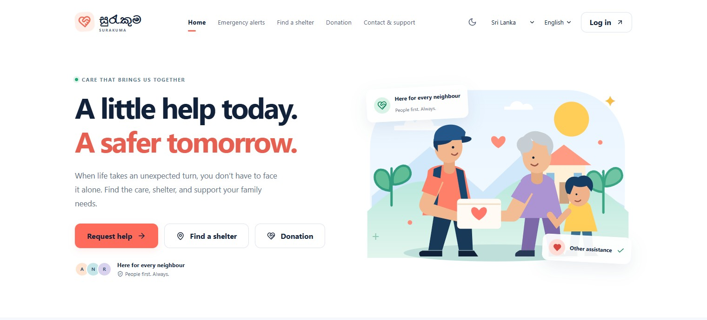
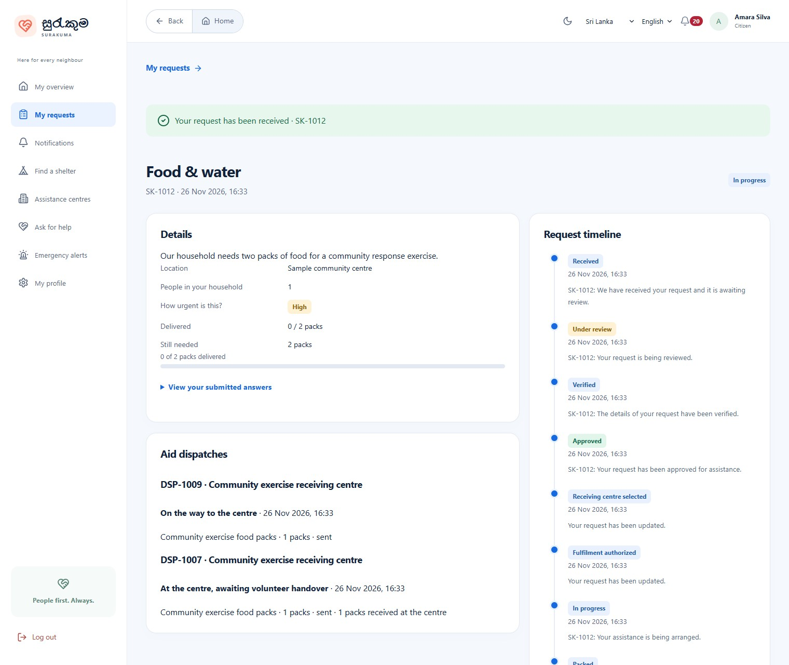
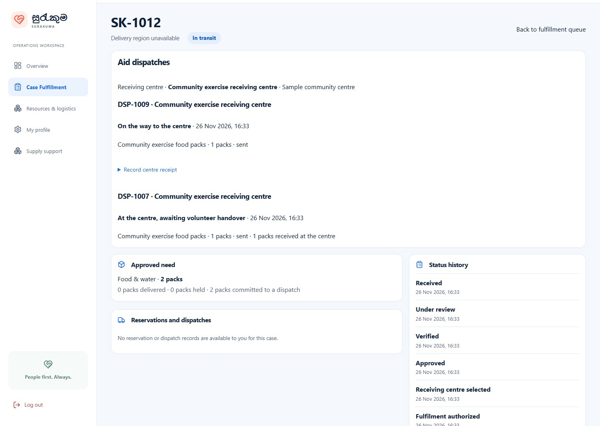

<p align="center">
  
</p>

<h1 align="center">Surakuma · සුරැකුම</h1>

<p align="center"><strong>Humanitarian aid coordination for communities and response teams</strong></p>

<p align="center">
  <a href="#what-you-can-do">What you can do</a> ·
  <a href="#how-gpt-6-luna-helps">How AI helps</a> ·
  <a href="#see-the-interface">See the interface</a> ·
  <a href="#run-on-windows">Run on Windows</a> ·
  <a href="#try-the-sample-data">Try the sample data</a> ·
  <a href="#project-team">Project team</a>
</p>

Surakuma connects the people who need help with the teams that organise it. A household can request food and water, medical support, temporary shelter, transport, or accessibility assistance. Response teams review the request, arrange support, and update its status so the household can see what happens next.



*Public homepage. Residents can request assistance, find a shelter, or read crisis alerts.*

## What you can do

| Workspace | What it helps you do |
| --- | --- |
| **Public and citizen** | Read crisis alerts, find shelters and assistance centres, request help, and follow updates on your requests. |
| **Case management and crisis coordination** | Review and prioritise requests, assign cases, coordinate the response, and publish approved alerts. Staff review triage suggestions before acting on them. |
| **Logistics and shelters** | Reserve supplies, manage dispatch and delivery, and track shelter availability and household placements. |
| **Volunteers** | Coordinate assignments, track availability, and submit field updates. |
| **Donors and funding teams** | Record monetary or material pledges, verify receipts, and track how donations are allocated. |
| **Administration and partners** | Manage users, organisations, permissions, and scoped access. Review activity through the audit trail. |

### Follow a request from submission to delivery

1. A resident submits a food request with the quantity needed and a location.
2. A case manager reviews the details and records the assessment. A coordinator can follow the case within the assigned response.
3. Logistics staff reserve supplies, dispatch them, and record what was delivered.
4. The resident returns to **My requests** to see the updated status.

## How GPT-6 Luna helps

**Finding the right form.** A resident writes “We need drinking water for our family” and selects **Help me choose with AI**. Surakuma can suggest **Food & water**. The resident chooses the category and submits the request.

| Where it helps | What Surakuma offers |
| --- | --- |
| **Citizen guidance** | Suggests a request category in English, Sinhala, Tamil, Hindi, or Nepali. It can also rephrase approved guidance on where to go in the portal. |
| **Case review** | Summarises structured intake, suggests a practical next check, and flags potentially related requests for review. Staff assess the evidence and record their decisions. |
| **Updates and public alerts** | Helps draft short citizen messages and public alert translations for review. It can also summarise already published alerts and generate illustrative artwork. |
| **Response planning** | Drafts briefing notes from aggregate figures, explains forecasts calculated by Surakuma, and suggests a skill label from the volunteer roster. |

### How it is implemented

The ASP.NET Core backend calls the **OpenAI Responses API** with GPT-6 Luna `gpt-6-luna` as the configured text model. It requests strict JSON schema output and validates the response before showing it in the interface. Related-request matching uses the separate `text-embedding-3-small` model when configured, and alert illustrations use the separate `gpt-image-2` image model by default.

The category helper strips email addresses, links, and phone-like patterns from the short description before sending it to the provider. Staff assessments use selected intake fields and the priority calculated by Surakuma. Configure provider credentials on the backend through `Ai__OpenAiApiKey` or `OPENAI_API_KEY`. Some tasks, including operational briefings and alert translation, have their own settings.

Without the provider, the category helper can use local multilingual rules and the portal can display its approved guidance. Staff see the recorded intake and calculated priority when an assessment is unavailable. Related-request matching can use local text overlap when embeddings are unavailable.

## See the interface

| **Citizen request form** | **My requests** |
| --- | --- |
|  |  |
| The optional helper suggests a category. This capture shows local guidance. | Residents can follow their supplies as they move through the receiving centre. |

| **Case Manager workspace** | **Dispatch and delivery** |
| --- | --- |
|  |  |
| Case managers can inspect the analysis and record a review decision. This capture shows a rule-based fallback. | Logistics staff can track dispatches and deliveries for the case. |

The screenshots use fictional records in a separate development database.

## Run on Windows

Install the **.NET 10 SDK**, **Node.js 24 with npm**, and **SQL Server Express LocalDB**. Use a Windows account with permission to create a database. The first setup downloads NuGet and npm dependencies.

Clone with Git, or use **Code → Download ZIP** on GitHub and open PowerShell in the extracted repository folder.

```powershell
git clone https://github.com/malithgimhana/surakuma.git
cd surakuma
```

### 1. Set up the database and start the API

From the repository root in PowerShell:

```powershell
sqllocaldb start MSSQLLocalDB
dotnet dev-certs https --trust

$env:ConnectionStrings__Default = 'Server=(localdb)\MSSQLLocalDB;Database=Surakuma;Trusted_Connection=True;TrustServerCertificate=True;Connect Timeout=10'
$env:Email__Provider = 'Capture'

.\scripts\Setup.ps1 -SqlServer '(localdb)\MSSQLLocalDB'
.\scripts\Start-Api.ps1
```

Setup installs dependencies, applies migrations, and populates a fresh development database with sample data. On later starts, set the same environment variables in the API terminal and run `Start-Api.ps1`. For a running `.\SQLEXPRESS` instance, use `.\scripts\Setup.ps1` and the default database connection.

### 2. Start the website

Leave the API running. In a second PowerShell terminal at the repository root:

```powershell
.\scripts\Start-Web.ps1
```

| Open | What to check |
| --- | --- |
| [Website](http://localhost:5173) | The homepage and sign-in screen load. |
| [Database readiness](http://localhost:5173/api/v1/ready) | HTTP `200` confirms the API can reach the database. |
| [Swagger UI](https://localhost:7043/swagger) | Browse and try the development API endpoints. |

If readiness returns `503`, check that SQL Server is running and that setup and the API use the same instance.

## Try the sample data

A fresh development database includes sample crises, requests, shelters, and accounts. The sample accounts share a password generated on your computer. Read it locally:

```powershell
(Get-Content .\backend\data\development-settings.json | ConvertFrom-Json).Seed.Password
```

| Sample account | What to try |
| --- | --- |
| `citizen@surakuma.test` | Submit an aid request and track it. |
| `case@surakuma.test` | Review cases and record an assessment. |
| `logistics@surakuma.test` | Explore stock and the dispatch workflow. |
| `admin@surakuma.test` | See users, organisations, and audit history. |

The local walkthrough uses sample data, captured email, and rule-based triage. It runs without external API keys.

### Sri Lanka assessment role checklist

For the prepared Sri Lanka demonstration, the project team can arrange private sign-in access to the existing accounts. Those accounts belong to the prepared SQL database. A fresh clone seeds its own sample data using the setup above.

| Role | What to demonstrate |
| --- | --- |
| **Country Administrator** | Review country-scoped organisations, staff access, and activity. |
| **Case Manager** | Review requests and record case decisions. |
| **Crisis Coordinator** | Oversee an assigned crisis and coordinate case fulfilment. |
| **Logistics** | Reserve stock, dispatch supplies, and record delivery. |
| **Shelter Administrator** | Manage shelter availability, placements, and check-in. |
| **Volunteer Coordinator** | Review the roster and assign volunteers. |
| **Volunteer** | Open assigned tasks and record progress. |
| **Citizen** | Submit a request and follow its progress. |
| **Funding Officer** | Review campaigns, receipts, and allocations. |
| **Donor** | Record a pledge and track contribution updates. |

## How the repository is organised

| Folder | What it contains |
| --- | --- |
| [`frontend`](frontend) | React, TypeScript, and Vite web app, with unit and browser tests. |
| [`backend`](backend) | ASP.NET Core 10 API, business rules, EF Core migrations, and backend tests. |
| [`database`](database) | SQL Server schema reference. The setup script applies the EF Core migrations. |
| [`scripts`](scripts) | PowerShell scripts to set up, run, test, and package the project. |

To run the backend tests, frontend build, and frontend tests with LocalDB:

```powershell
$env:SURAKUMA_TEST_SERVER = '(localdb)\MSSQLLocalDB'
.\scripts\Test.ps1
```

## Project team

| Contributor | Repository work area |
| --- | --- |
| [Malith Gimhana](https://github.com/malithgimhana) | Public and citizen frontend |
| [Navitha Thewnim](https://github.com/navithathewnim17-hub) | Staff and administration frontend |
| [MAY-Vimansa](https://github.com/MAY-Vimansa) | Backend API and security |
| [Sanju Hansamal](https://github.com/sashansamal) | Backend business logic and integrations |
| [Ravishka Nirmal](https://github.com/WRR-Nirmal) | Database and data access |
| [ipjrathnayake](https://github.com/ipjrathnayake) | Testing, integration, and delivery |
