<p align="center">
  
</p>

<h1 align="center">Surakuma · සුරැකුම</h1>

<p align="center"><strong>AI-Assisted Humanitarian Crisis Management Platform</strong></p>
<p align="center">A shared workspace for communities and response teams to request, coordinate and verify humanitarian assistance.</p>

<p align="center">
  
  
  
  
  
  <a href="https://github.com/malithgimhana/surakuma/actions/workflows/ci.yml"></a>
</p>

<p align="center">
  <a href="#features">Features</a> ·
  <a href="#roles-and-access">Roles</a> ·
  <a href="#assistance-workflow">Workflow</a> ·
  <a href="#ai-decision-support">AI</a> ·
  <a href="#application-gallery">Gallery</a> ·
  <a href="#getting-started">Setup</a> ·
  <a href="#demonstration-and-assessment">Demo</a>
</p>

## Overview

During a crisis, requests, stock counts, shelter availability and field updates can arrive through different channels. Surakuma gives households a way to ask for assistance and track it, and gives response organisations a shared case record for prioritisation, allocation, handoffs and verified outcomes. Coordinators and administrators can use the same operational data to see demand, capacity and delivery gaps.

Surakuma is a university software engineering project with country-specific services for **Sri Lanka (LK), India (IN) and Nepal (NP)**. The application includes a country selector, administrative divisions, emergency contact directories and country-scoped operational records for all three. Related national crises can be grouped under an international incident while each retains its own access rules. AI assists with reviewing and communicating decisions. Authorised staff decide what aid is approved, assigned, published and recorded as delivered. [Geography endpoints](backend/src/Surakuma.Api/Controllers/GeographyController.cs) · [Country selector](frontend/src/geography.tsx)

**Contents** · [Overview](#overview) · [Features](#features) · [Roles and access](#roles-and-access) · [Assistance workflow](#assistance-workflow) · [AI decision support](#ai-decision-support) · [Architecture](#architecture) · [Gallery](#application-gallery) · [Stack](#technology-stack) · [Setup](#getting-started) · [Configuration](#environment-configuration) · [Assessment](#demonstration-and-assessment) · [Testing](#testing-and-quality-assurance) · [CI and delivery](#ci-and-delivery) · [Security](#security-and-privacy) · [Repository](#repository-structure) · [Team](#project-team)

## Features

| Area | Implemented workflow |
| --- | --- |
| Crises and public alerts | Manage crisis records, response areas and assignments. Draft, review, publish and expire country-specific alerts with required translations. |
| Citizen assistance | Submit and track food and water, medical, shelter, transport, accessibility and other requests. Category-specific intake supports drafts, location details, evidence and follow-up feedback. |
| Case management | Route eligible cases automatically or handle them in staff triage, assign a case manager, review evidence and recommendations, record decisions and escalate issues. |
| Emergency coordination | Use country and crisis queues to assign teams, authorise fulfilment, select receiving centres and share specific work with eligible partners. |
| Resources and logistics | Manage depots, stock movements, shortages and inter-organisation supply support. Reserve, pack and dispatch supplies, record receipts and track partial deliveries by quantity and unit. |
| Shelter management | Register and manage shelters, capacity, facilities and accessibility. Review suitability, reserve household places, record check-in and release capacity on departure. |
| Volunteers | Maintain verified rosters, skills and availability, assign eligible volunteers, and verify or return completion reports and centre handovers. |
| Donors and funding | Manage campaigns, monetary and material pledges, receipt confirmation, allocations, expenses and investigations. Financial receipts are recorded from external transactions. Online payment processing is unavailable. |
| AI decision support | Review intake classifications, priority signals, potential duplicates, candidate rankings, forecasts and communication drafts. Provider-dependent options and local calculations are described [below](#ai-decision-support). |
| Languages | English, Sinhala, Tamil, Hindi and Nepali interface and intake support, with country-specific alert language requirements and localised citizen messages. |
| Mapping and locations | Country and region selection, maps, coordinates and text locations. Optional forward/reverse geocoding and driving routes use openrouteservice. |
| Notifications | Citizen status updates, scoped staff and citizen inboxes, Brevo email or local capture, and optional browser push for supported events. |
| Reports and analytics | Country- and scope-filtered operational dashboards and reports, with CSV and PDF export for authorised administrators. |
| Administration and audit | Manage staff access, country-level organisation verification, service access, sensitive-change review, delivery monitoring and recorded audit history. |

## Roles and access

| Workspace | Role identifier | Actions and data scope |
| --- | --- | --- |
| System Administrator | `Administrator` | Manages system access, organisations, audits, reports and delivery oversight across countries. Can narrow views to a selected country. |
| Country Administrator | `CountryAdministrator` | Manages staff access, partner verification, reviewed alerts and operational reporting in granted countries. |
| Case Manager | `CaseManager` | Reviews assigned and eligible scoped cases, verifies needs, records AI decisions and request status, and closes fulfilled cases. The case manager workspace requires one assigned country. |
| Crisis Coordinator | `Coordinator` | Oversees assigned crises, handles routing, prepares alerts, authorises fulfilment and coordinates receiving centres and assignments. Organisation grants also govern inventory visibility. |
| Logistics Officer | `Logistics` | Manages stock, packing, dispatch, receipts and delivery exceptions within assigned country, organisation and, where configured, depot or crisis. |
| Shelter Administrator | `ShelterAdmin` | Registers and manages shelters, reviews placement candidates and records stays in the assigned country and organisation. |
| Volunteer Coordinator | `VolunteerCoordinator` | Verifies volunteers, reviews availability, assigns tasks and verifies reports or handovers in granted country and organisation scopes. |
| Volunteer | `Volunteer` | Manages own profile and availability, accepts or declines assigned work and reports progress and outcomes. |
| Citizen | `Citizen` | Submits and tracks own requests, reads notifications and records feedback. Public directories and published alerts are available by country. |
| Funding Officer | `FundingOfficer` | Manages eligible campaigns, reconciles financial receipts, and records allocations and expenses within granted country and organisation scopes. |
| Donor | `Donor` | Maintains own donor profile, pledges to eligible campaigns and tracks own contributions. |
| Partner | `Partner` | Views explicitly shared case work and manages eligible organisation commitments and supply support within its verified scope. |

The API checks active roles and memberships against the relevant country, organisation, crisis or depot. A country selector filters authorised records and cannot extend access. Organisation-scoped administration uses existing role grants, and the role catalogue has no separate Organisation Administrator. [Role definitions](backend/src/Surakuma.Domain/Models.cs) · [Access rules](backend/src/Surakuma.Application/Ports.cs) · [Workspace routes](frontend/src/main.tsx)

## Assistance workflow

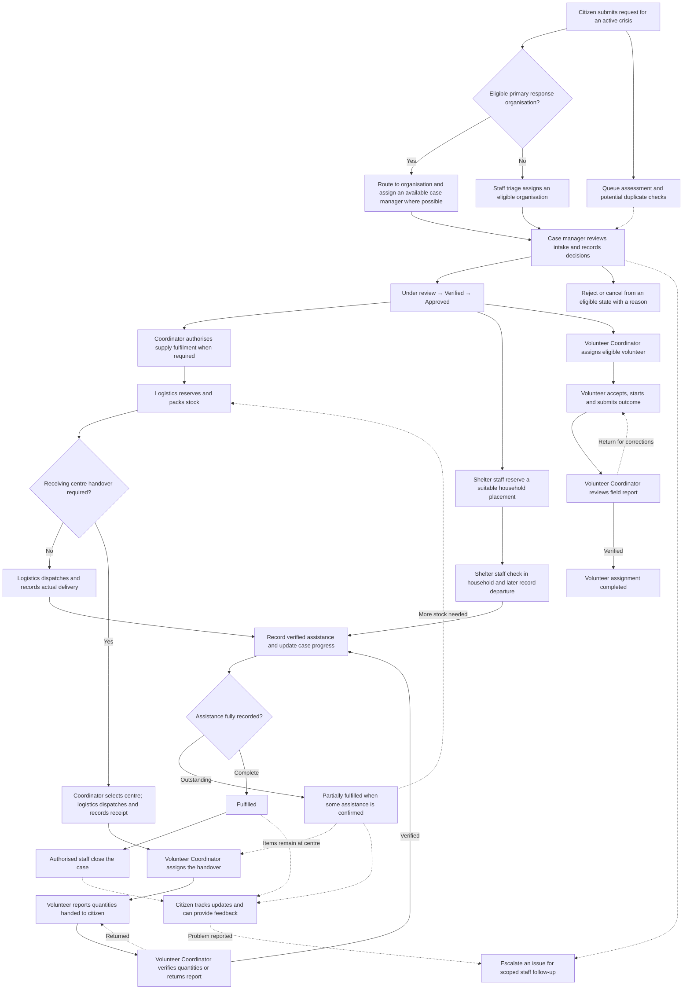

Authorised staff can route an unassigned case or choose an eligible case manager. For supplies, **receipt at the centre and confirmed handover to the citizen are separate events**. Verifying a general volunteer task completes that assignment. Verifying a linked handover can advance the aid quantity on the case. Citizen status and history update throughout the workflow. [Case operations](backend/src/Surakuma.Application/Operations.cs) · [Fulfilment endpoints](backend/src/Surakuma.Api/Controllers/FulfillmentController.cs) · [Centre handover](backend/src/Surakuma.Application/CentreDispatches.cs)

## AI decision support

Surakuma shows the source of a recommendation and records staff decisions. Staff can approve, modify or reject a recommendation. Operational permissions and validation still govern the resulting action.

| Coursework capability | Implementation | Method | Human review | Status |
| --- | --- | --- | --- | --- |
| 1. Request classification | An optional intake helper suggests a form category. A background job assesses the submitted case and suggests categorisation using eligible input. | Hybrid. OpenAI text generation with local vocabulary and structured-intake rules. | Citizen chooses the submitted category. Staff review changes to the recorded case. | Implemented with local fallback |
| 2. Urgency and priority | Structured intake, immediate danger, needs signals and waiting time inform priority. | Rule-based scoring. AI can extract supporting signals where enabled. | Staff review and can record a different priority. | Implemented locally |
| 3. Near-duplicate detection | Compares eligible recent cases using scope, time, location and text evidence. Uses cosine similarity when embeddings are available. | Hybrid. OpenAI embeddings and local comparisons, with local text matching available. | Staff mark possible duplicates as confirmed or distinct before consolidation. | Implemented with optional embeddings |
| 4. Resource matching | Filters and ranks stock by category, compatible units, availability, suitability, distance and competing demand. | Rules and ranking over operational records. | Staff choose and reserve stock against authorised needs. | Implemented locally |
| 5. Shelter recommendation | Filters by eligibility, capacity and accessibility, then ranks suitable options. | Rules and ranking. | Shelter staff review and reserve the placement. | Implemented locally |
| 6. Volunteer matching | Ranks verified candidates by skill, availability, conflicts, service area and workload. OpenAI can suggest a standard skill label. | Rules for eligibility and rank, optional OpenAI extraction. | Coordinator selects the volunteer and verifies the result. | Implemented with optional AI assistance |
| 7. Demand forecasting | Compares historical weekly baselines, reports validation error and an empirical range, and withholds estimates when data is sparse. | Statistical calculation. Optional OpenAI interpretation of aggregates. | Coordinator reviews the evidence before using it to plan. | Implemented with data requirements |
| 8. Suspicious or anomalous requests | Flags patterns such as repeated similar submissions and atypical quantities for investigation. | Local rules and comparative signals, including duplicate evidence when available. | Staff confirm or dismiss findings. Flags leave case status unchanged. | Implemented as advisory flags |
| 9. Multilingual responses and notifications | Drafts citizen updates and eligible public alert translations. Standard status emails use localised templates and can include reviewed copy. | OpenAI text drafts with manual wording and deterministic templates available. | Staff review and publish drafts. Alerts follow their approval workflow. | Implemented with optional generation |
| 10. Crisis summaries | Builds operational briefings from scoped aggregate case, stock, shelter and volunteer data. | Local aggregates with optional OpenAI-generated interpretation. | An independent authorised administrator records a review note. | Implemented, OpenAI briefing generation opt-in |

The configured text model is **`gpt-6-luna`**. OpenAI text tasks use the Responses API with schema-validated structured output and `store: false`. The intake category task has its own model override. Similarity uses **`text-embedding-3-small`** with 256 dimensions. Optional public alert illustrations use the Images API and default to **`gpt-image-2`**. Provider and model settings describe the code’s configuration. Live execution depends on account access, feature flags and service availability. [Provider implementation](backend/src/Surakuma.Infrastructure/AiProvider.cs) · [Decision support](backend/src/Surakuma.Application/DecisionSupport.cs)

## Architecture

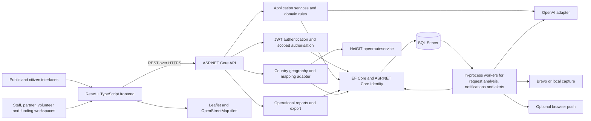

The solution builds one ASP.NET Core API from four projects. **API** hosts HTTP endpoints, Swagger and access checks. **Application** runs use cases and defines provider and persistence interfaces. **Domain** holds records and transition rules. **Infrastructure** implements EF Core, migrations, Identity and provider adapters. SQL-backed jobs and the notification outbox are processed by hosted workers in the API process. [Solution](backend/Surakuma.sln) · [API composition](backend/src/Surakuma.Api/Program.cs)

## Application gallery


*Public homepage for finding and requesting assistance. All gallery captures use fictional demonstration or test records.*

| Citizen dashboard | Assistance request |
| --- | --- |
| 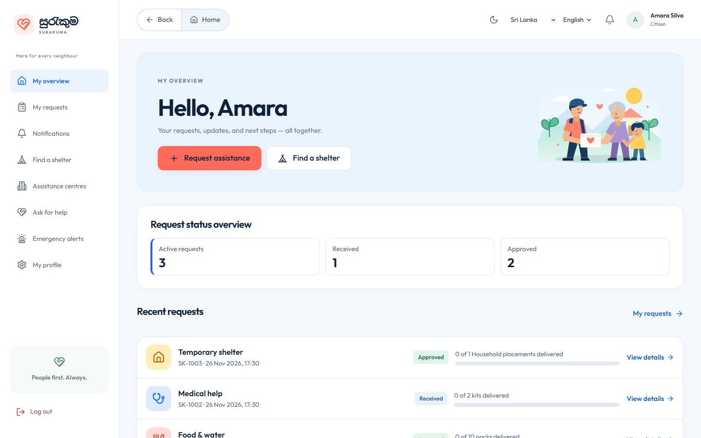 | 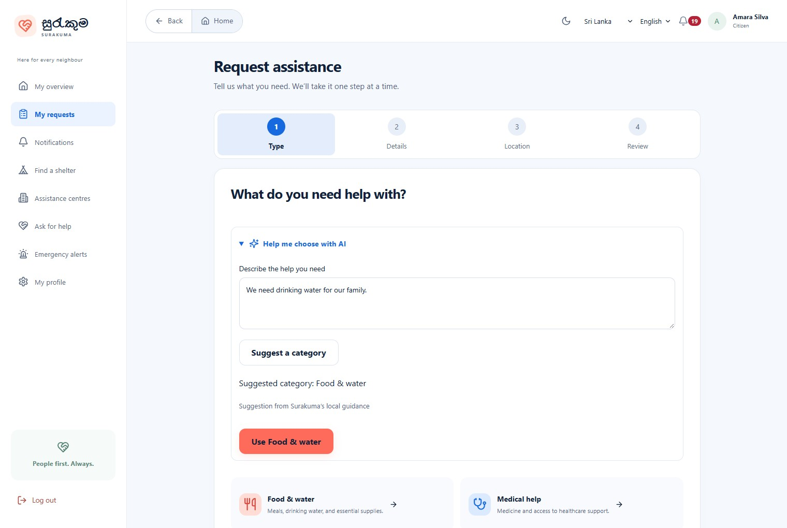 |
| Review active requests and find services. | Choose a request category and open its intake form. |

| Request tracking | Case Manager and AI review |
| --- | --- |
|  | 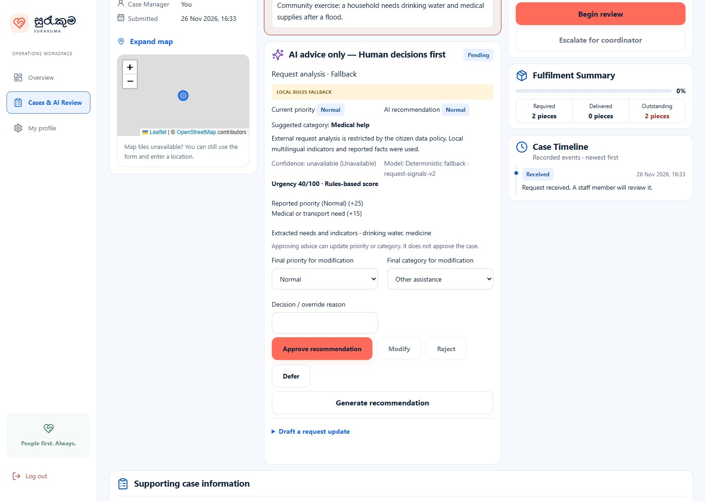 |
| Follow a dispatch through the receiving centre. | Inspect rule-based assessment evidence and record a decision. |

| Crisis coordination | Logistics |
| --- | --- |
| 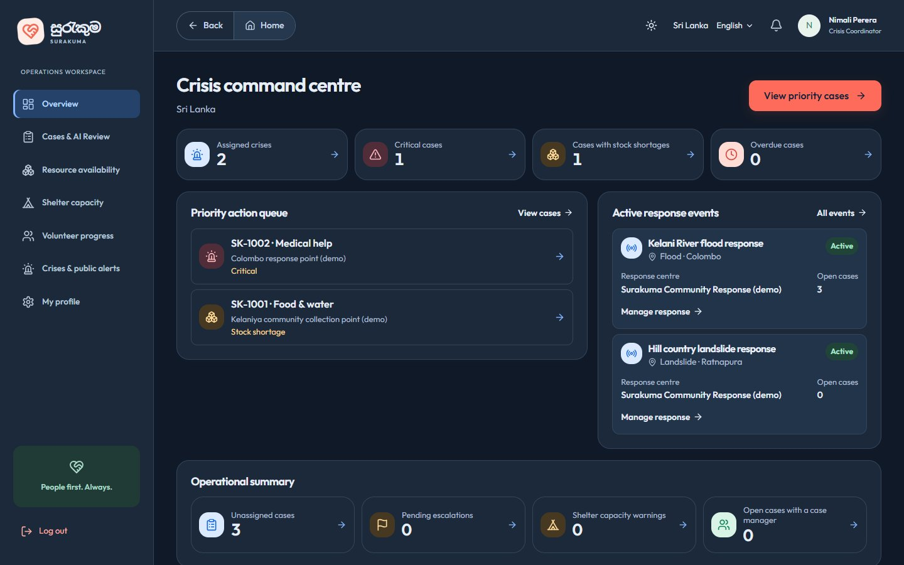 |  |
| Review the assigned response and work awaiting action. | Track packing, dispatch and delivery for approved assistance. |

| Shelter administration | Volunteer coordination |
| --- | --- |
| 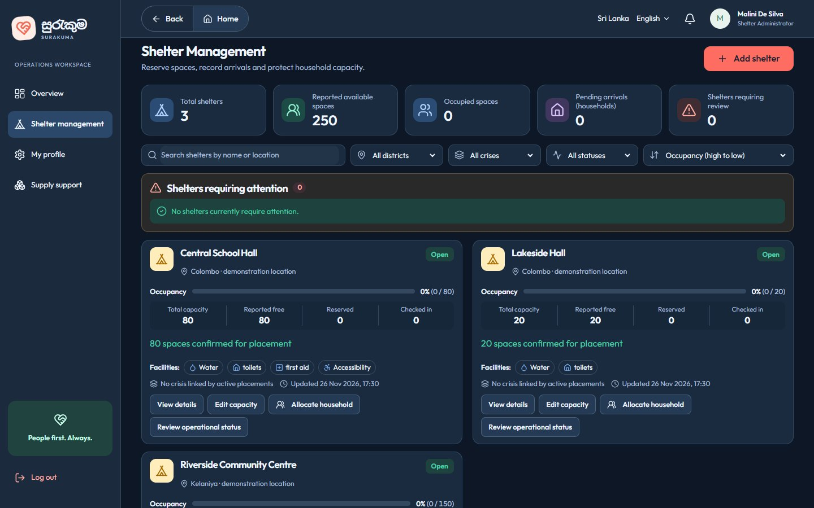 | 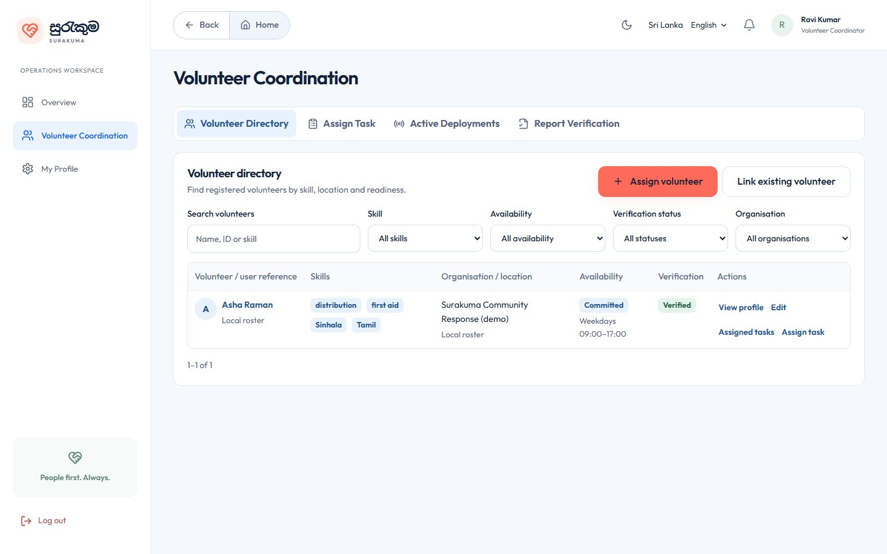 |
| Manage shelters and household placements. | Organise assignments and review field work. |

| Country administration | Operational reports |
| --- | --- |
| 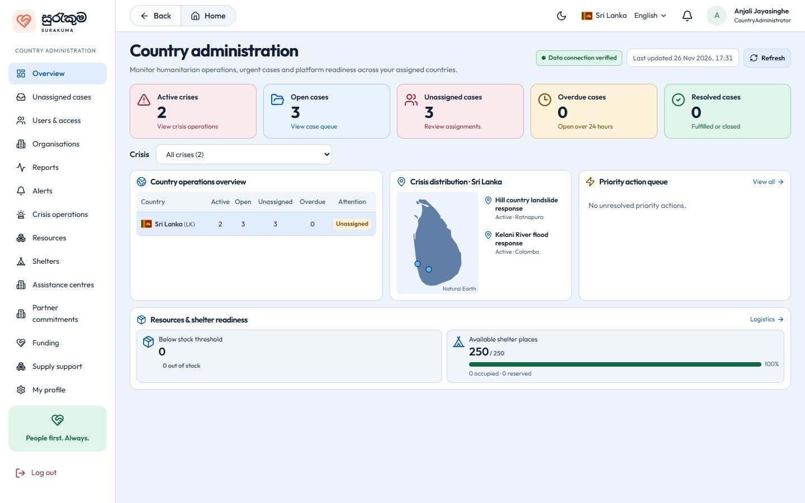 | 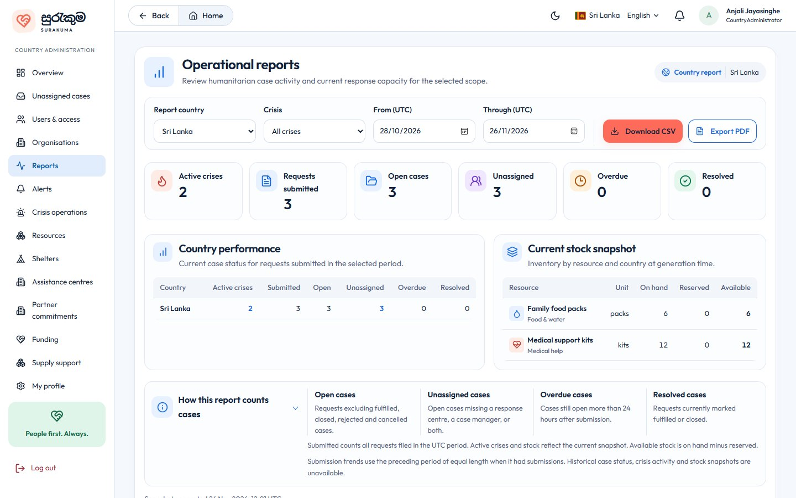 |
| See country-scoped operations, access and activity. | Filter response metrics and export a report. |

## Technology stack

| Layer | Technologies verified in source |
| --- | --- |
| Frontend | React 19.3.1, TypeScript 5.9.3, Vite 7.3.7, Tailwind CSS 4.3.3, React Router 7.18.4, TanStack Query 5.104.4 and i18next 25.10.10, as resolved in the lockfile. |
| Backend | C#, .NET / ASP.NET Core 10, REST, Swashbuckle 10.1.0 and Microsoft HTTP resilience 10.10.0. |
| Database | SQL Server with EF Core SQL Server 10.0.6 and versioned migrations. LocalDB is used in CI. |
| AI | OpenAI Responses, Embeddings and Images APIs, alongside local rules, ranking and statistical forecasts. |
| Authentication | ASP.NET Core Identity EF 10.0.6, JWT bearer authentication and rotating refresh tokens. |
| Communication | Brevo transactional email API, SQL-backed outbox, local capture, in-app notifications and optional Web Push using Lib.Net.Http.WebPush 3.3.1. |
| Mapping | Leaflet 1.9.4, React Leaflet 5.0.0, OpenStreetMap tiles and HeiGIT openrouteservice. |
| Reporting | Recharts 3.10.1, server-side CSV export and PDFsharp-MigraDoc 6.2.4. |
| Testing | xUnit 2.9.3, ASP.NET Core test host 10.0.6, Vitest 3.2.7, Testing Library, Playwright 1.64.1 and axe-core Playwright 4.14.0. |
| DevOps | PowerShell scripts and GitHub Actions on Windows with .NET 10 and Node.js 24. |

[Frontend lockfile](frontend/package-lock.json) · [API packages](backend/src/Surakuma.Api/Surakuma.Api.csproj) · [Infrastructure packages](backend/src/Surakuma.Infrastructure/Surakuma.Infrastructure.csproj) · [Test packages](backend/tests/Surakuma.Tests/Surakuma.Tests.csproj)

## Getting started

Use **Windows, Git, the .NET 10 SDK, Node.js 24 with npm, and SQL Server Express LocalDB**. A running SQL Server Express or Developer instance also works. Use a Windows account with permission to create the development database. PowerShell 7 and Microsoft Edge are needed for the isolated browser suite. The initial dependency restore needs internet access.

### 1. Clone and set up the local database

Run these commands in PowerShell.

```powershell
git clone https://github.com/malithgimhana/surakuma.git
Set-Location surakuma

sqllocaldb start MSSQLLocalDB
dotnet dev-certs https --trust
.\scripts\Setup.ps1 -SqlServer '(localdb)\MSSQLLocalDB'
```

[Setup.ps1](scripts/Setup.ps1) restores the .NET tools and solution, runs `npm ci`, applies EF Core migrations and seeds an empty development database named `Surakuma`. Use a fresh local SQL instance for the demonstration if that name is already used by an assessment database. For a running `.\SQLEXPRESS` instance, run `.\scripts\Setup.ps1` and use the default API connection.

### 2. Start the API

In a PowerShell terminal at the repository root, use the same instance as setup. The commands below use LocalDB.

```powershell
$env:ConnectionStrings__Default = 'Server=(localdb)\MSSQLLocalDB;Database=Surakuma;Trusted_Connection=True;TrustServerCertificate=True;Connect Timeout=10'
$env:Email__Provider = 'Capture'
.\scripts\Start-Api.ps1
```

When using the default `.\SQLEXPRESS` instance, omit the connection override. Repeat the environment settings when opening a fresh API terminal. [Start-Api.ps1](scripts/Start-Api.ps1)

### 3. Start the frontend

Leave the API running and execute this command in a second PowerShell terminal at the repository root.

```powershell
.\scripts\Start-Web.ps1
```

| Local URL | Purpose |
| --- | --- |
| [http://localhost:5173](http://localhost:5173) | Website and sign-in |
| [https://localhost:7043](https://localhost:7043) | HTTPS API origin. The launch profile also binds HTTP on port 5043. |
| [https://localhost:7043/swagger](https://localhost:7043/swagger) | Swagger UI in Development |
| [https://localhost:7043/api/v1/health](https://localhost:7043/api/v1/health) | API liveness |
| [https://localhost:7043/api/v1/ready](https://localhost:7043/api/v1/ready) | Database readiness. Expect HTTP 200 when reachable. |

Vite proxies `/api` to the HTTPS API. Use `localhost` consistently for the local browser session. [Start-Web.ps1](scripts/Start-Web.ps1) · [API launch settings](backend/src/Surakuma.Api/Properties/launchSettings.json)

<details>
<summary>Troubleshooting</summary>

| Symptom | What to check |
| --- | --- |
| SQL connection failure or readiness returns 503 | Start the correct SQL instance and check Windows authentication, database creation rights and that setup and API startup point to the same instance. |
| Port already in use | Check the process using 5173, 7043 or 5043 and stop it if it is yours. For custom API ports, update the launch profile and Vite proxy together or set `SURAKUMA_API_PROXY`. |
| HTTPS certificate warning | Run `dotnet dev-certs https --trust`, accept the Windows trust prompt and restart the API and browser. |
| Missing commands or dependencies | Check `git --version`, `dotnet --list-sdks` and `node --version`. Reopen PowerShell after installing tools, then rerun setup. |
| Seed account sign-in fails | Use the password that originally seeded that database. Recreating the settings file creates a new password for future seeds. |

</details>

## Environment configuration

Set ASP.NET Core variables in the API terminal before startup. Development generates its own signing key and seed password in the Git-ignored `backend/data/development-settings.json`. The same configuration can be overridden by environment variables. The API startup script imports only `Mapping__ApiKey` from the root `.env` when that variable is absent from the terminal.

| Variable | Purpose | Local requirement |
| --- | --- | --- |
| `ConnectionStrings__Default` | SQL Server connection. Default is `.\SQLEXPRESS`, database `Surakuma`, with Windows authentication. | Set for LocalDB or any other instance. |
| `Jwt__Key`, `Jwt__Issuer`, `Jwt__Audience` | Signing key of at least 32 characters and token validation settings. | Development supplies the key and issuer/audience defaults. Supply a strong key outside Development. |
| `Seed__Password` | Override the generated seed password for an empty development database. | Optional. |
| `Email__Provider` | `Brevo` is configured in appsettings. Use `Capture` to record notification outcomes locally. | Set to `Capture` for the demonstration. |
| `Email__ApiKey`, `Email__Sender`, `Email__PortalBaseUrl` | Brevo credential, verified sender and link origin. Set the portal origin explicitly for live recovery and invitation flows. | Optional in Capture. |
| `Ai__OpenAiApiKey` or `OPENAI_API_KEY` | Server-side OpenAI credential. | Optional. Local triage and manual review are available. |
| `Ai__OpenAiModel`, `Ai__Tasks__<task>__Provider`, `Ai__Tasks__<task>__Model` | Configure text models and per-task modes such as `OpenAI` or `Rules`. | Optional. The embedding model has its own fixed default. |
| `Ai__EnableRestrictedTriage`, `Ai__ApprovedSyntheticAccountIds__0` | Opt in to restricted structured case triage or allowlist a verified synthetic account for demo-text triage. | Optional. Leave unset for a local rules demonstration. |
| `Ai__OperationalBriefingsEnabled`, `Ai__PublicTranslationEnabled`, `Ai__AlertImagesEnabled`, `Ai__AlertImageModel` | Control aggregate briefing and public translation generation, and alert illustration availability/model. | Optional. Briefings and translations default to off. |
| `Mapping__ApiKey` | Enables forward and reverse geocoding and driving routes via HeiGIT openrouteservice. | Optional. Text locations and public tiles work independently of this key. Tiles need internet access. |
| `BrowserPush__PublicKey`, `BrowserPush__PrivateKey`, `BrowserPush__Subject` | VAPID settings for opt-in browser push. | Optional. |
| `Storage__EvidencePath`, `Cors__Origins__0` | Override upload storage or the allowed frontend origin when needed. | Optional with the default local layout. |
| `VITE_API_URL`, `SURAKUMA_API_PROXY` | Frontend API base path and Vite development proxy target. | Optional. Defaults use the ports above. |

Keep real secrets in environment variables or ignored local settings and use placeholders in shared configuration. [API defaults](backend/src/Surakuma.Api/appsettings.json) · [Integration configuration](backend/src/Surakuma.Infrastructure/IntegrationConfiguration.cs)

## Demonstration and assessment

### A. Local development demonstration

On a newly seeded database, the eight fictional accounts share a password generated on that computer. Read only the password from the repository root.

```powershell
(Get-Content .\backend\data\development-settings.json | ConvertFrom-Json).Seed.Password
```

| Seed account | Workspace | Seed account | Workspace |
| --- | --- | --- | --- |
| `citizen@surakuma.test` | Citizen | `case@surakuma.test` | Case Manager |
| `coordinator@surakuma.test` | Crisis Coordinator | `logistics@surakuma.test` | Logistics Officer |
| `shelter@surakuma.test` | Shelter Administrator | `volunteers@surakuma.test` | Volunteer Coordinator |
| `volunteer@surakuma.test` | Volunteer | `admin@surakuma.test` | System Administrator |

Use Capture email, local triage and manual location entry to rehearse without paid external APIs. The seed provides fictional Sri Lanka crises, requests, inventory, shelters and a volunteer task. Start with a food request in the citizen workspace, then follow the [assistance workflow](#assistance-workflow) through case review and delivery. The other application roles can be exercised with appropriate local account setup. [Seed source](backend/src/Surakuma.Infrastructure/SeedData.cs)

### B. Prepared Sri Lanka assessment environment

The Saviya Organisation walkthrough uses the existing assessment database and privately shared sign-ins. A fresh clone creates its own sample data and uses the local accounts above. The checklist includes country-wide and public-facing roles that take part in the Saviya response.

| Role to prepare | Checkpoint |
| --- | --- |
| Country Administrator | Review Sri Lanka organisations, staff access and activity. |
| Case Manager | Review request evidence and save a decision. |
| Crisis Coordinator | Confirm crisis scope and authorise fulfilment. |
| Logistics Officer | Reserve and pack stock, then record dispatch and receipt. |
| Shelter Administrator | Reserve a placement and check in the household. |
| Volunteer Coordinator | Assign a volunteer and verify the field report. |
| Volunteer | Accept the assignment and report the outcome. |
| Citizen | Submit a request, track progress and provide feedback. |
| Funding Officer | Review campaign receipts, allocations and expenses. |
| Donor | Pledge to a campaign and track the contribution. |

Share confirmed account details privately with the assessor. If supplied locally, store `ASSESSMENT-ACCESS-PRIVATE.md` under the ignored `backend/data/` directory.

## Testing and quality assurance

| Level | Coverage in the repository |
| --- | --- |
| Automated unit and component | xUnit domain, priority, allocation and provider rules. Vitest covers frontend components, role routing, scoped navigation, validation and API error states. |
| Automated API and integration | ASP.NET Core test host with real SQL Server migrations and disposable `Surakuma_Test_<guid>` databases. Tests exercise authentication, country and organisation access, case workflows, persistence and provider adapters. Provider behavior is exercised with controlled responses or capture where configured. |
| Automated browser | Playwright exercises public and staff journeys, cross-role case handoffs, localisation and selected accessibility checks. The isolated Edge suite starts the real API and frontend against synthetic data. |
| Manual acceptance | Sign in as a citizen and submit food and shelter cases. Review AI evidence and approve or override a suggestion as staff. Authorise fulfilment, confirm a partial supply delivery and the remainder, and check a household into a shelter. Verify citizen status, captured notification, feedback, closure and audit entries. Record observed outcomes for the assessor. |

Run the backend tests, production frontend build and Vitest from the repository root. The commands below use LocalDB.

```powershell
sqllocaldb start MSSQLLocalDB
$env:SURAKUMA_TEST_SERVER = '(localdb)\MSSQLLocalDB'
.\scripts\Test.ps1
```

The individual commands are `dotnet test backend/Surakuma.sln --verbosity minimal` from the root and `npm test` from `frontend`. Leave the test server override unset for the default `.\SQLEXPRESS` instance. [Test.ps1](scripts/Test.ps1)

After restoring dependencies and configuring the HTTPS development certificate, run the isolated Playwright suite from the repository root.

```powershell
pwsh -NoProfile -File .\scripts\Test-InternationalAcceptance.ps1
```

The runner uses Edge, isolated ports, local email capture and a unique `Surakuma_Acceptance_<guid>` LocalDB database that it retains for inspection. Some specs regenerate files in `docs/screenshots/` and `docs/testing/swagger-evidence.json`. Run the full suite in a disposable checkout to preserve existing evidence files.

For specs written to use the default local origin, start the API and frontend on a synthetic database, then run `npx playwright install chromium` and `npm run test:e2e` from `frontend`. Use the API's `-BrowserTests` mode for rapid role switching. [Playwright runner](scripts/Test-InternationalAcceptance.ps1) · [International browser scenarios](frontend/e2e/international-live.spec.ts)

## CI and delivery

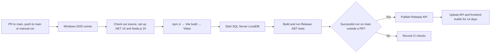

Open **Actions → Surakuma CI and delivery** to inspect jobs, step logs and build results. For successful pushes to `main` and successful manual runs on `main`, the run summary lists an artifact named `surakuma-<commit SHA>` containing `delivery/api/` and `frontend/dist/`. The workflow ends at artifact delivery. Browser acceptance runs separately, and live hosting is a separate deployment step. [Workflow file](.github/workflows/ci.yml) · [GitHub Actions](https://github.com/malithgimhana/surakuma/actions/workflows/ci.yml)

## Security and privacy

- ASP.NET Core Identity hashes passwords and limits repeated failed sign-ins. The API validates signed JWTs and security stamps. Refresh sessions use rotating tokens and HTTP-only cookies.
- Active memberships, scoped access checks and ownership checks protect records. Server-side validation covers status changes, stock and capacity, evidence uploads and sensitive operations.
- Fixed-window limits apply to the API and to sensitive routes such as authentication, maps and AI drafts. Audit events preserve the actor and action on operational changes.
- Provider requests use task-specific input controls. Standard case triage uses local rules by default. Restricted provider triage uses closed-set labels, and raw demo case text requires a server allowlist and the synthetic flag. The optional intake helper sanitises common contact details and links from the separately consented short description.
- Staff review generated recommendations, citizen communications and public alert changes through the relevant approval flow. Deployment secrets belong in environment configuration. Keep generated development settings, private account details and evidence out of version control.

[API security configuration](backend/src/Surakuma.Api/Program.cs) · [Authentication](backend/src/Surakuma.Infrastructure/Authentication.cs) · [Ignore rules](.gitignore)

## Repository structure

```text
.
├── .config/                             # Local .NET tool manifest
├── .github/workflows/ci.yml              # CI and build delivery
├── assets/readme/                       # Gallery images
├── frontend/
│   ├── public/                          # Branding and browser assets
│   ├── src/                             # React routes, workspaces and component tests
│   ├── e2e/                             # Playwright scenarios
│   └── package.json                     # Frontend dependencies and scripts
├── backend/
│   ├── Surakuma.sln
│   ├── src/
│   │   ├── Surakuma.Api/                 # REST API, controllers and appsettings
│   │   ├── Surakuma.Application/         # Use cases, permissions and service contracts
│   │   ├── Surakuma.Domain/              # Entities and state rules
│   │   └── Surakuma.Infrastructure/     # EF Core, migrations, adapters and seed data
│   └── tests/Surakuma.Tests/             # xUnit and SQL-backed API tests
├── database/scripts/                    # SQL schema reference
├── docs/                                # Local guides and assessment evidence
└── scripts/                             # Setup, startup, testing and packaging
```

## Project team

| Contributor | Repository work area |
| --- | --- |
| [Malith Gimhana](https://github.com/malithgimhana) | Public and citizen frontend |
| [Navitha Thewnim](https://github.com/navithathewnim17-hub) | Staff and administration frontend |
| [MAY-Vimansa](https://github.com/MAY-Vimansa) | Backend API and security |
| [Sanju Hansamal](https://github.com/sashansamal) | Backend business logic and integrations |
| [Ravishka Nirmal](https://github.com/WRR-Nirmal) | Database and data access |
| [ipjrathnayake](https://github.com/ipjrathnayake) | Testing, integration, and delivery |
