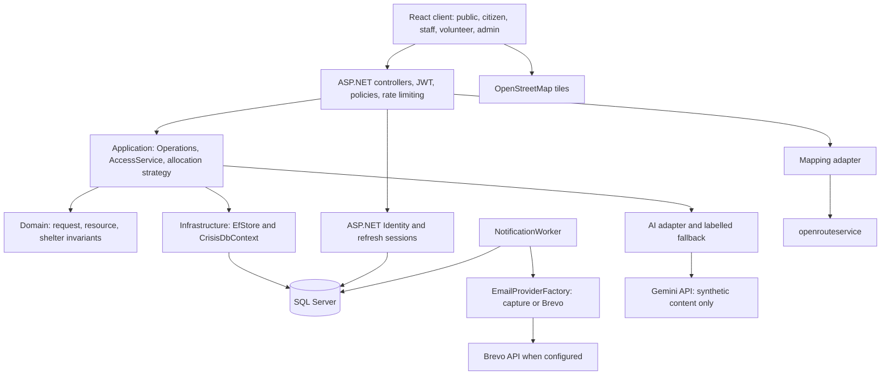
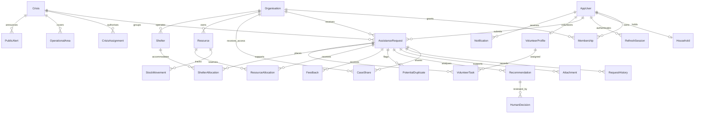

# Editable architecture diagrams

These Mermaid diagrams describe the implemented core. Use-case source is in `use-cases.puml`. Render these sources in a Mermaid/PlantUML-capable editor for the report.

## Components



## Class diagram

```mermaid
classDiagram
    class AssistanceRequest {
        Guid Id
        string CitizenId
        Guid CrisisId
        Guid OrganisationId
        AidCategory Category
        Priority Priority
        RequestStatus Status
        decimal Quantity
        decimal DeliveredQuantity
        Transition(next, reason)
        Deliver(quantity)
    }
    class Resource {
        decimal Stock
        decimal Reserved
        decimal Available
        Reserve(quantity)
        Dispatch(quantity)
        Release(quantity)
    }
    class ResourceAllocation { decimal Quantity; AllocationStatus Status }
    class Shelter {
        int Capacity
        int Reserved
        int Occupancy
        int Available
        Reserve(count)
        CheckIn(count)
        Release(count, checkedIn)
    }
    class ShelterAllocation { int People; StayStatus Status }
    class Recommendation { string Provider; string Model; bool Fallback; NullableDouble Confidence; string ReviewState }
    class HumanDecision { string ActorId; string Action; string Reason; Priority FinalPriority }
    class RequestHistory { string Status; string ActorId; string Note }
    class VolunteerProfile { string UserId; string Skills; string Availability; bool Verified; bool Available }
    class VolunteerTask { string Title; string RequiredSkill; TaskStatus Status; DateTimeOffset DueAt }
    class OutboxMessage { string State; int Attempts; DateTimeOffset NextAttemptAt }
    class NotificationDelivery { Guid EventId; string RecipientId; string State }
    class Operations { Submit(); ChangeStatus(); GenerateAi(); Decide(); Allocate(); Place(); AssignTask() }
    class AccessService { Visible(); Request(); RequireOrg(); Coordinates() }
    class IStore { <<interface>> Query(); FindAsync(); SaveAsync(); TransactionAsync() }
    class EfStore
    class IAllocationPolicy { <<interface>> Validate() }
    class ConstraintAllocationPolicy
    Operations --> AccessService
    Operations --> IStore
    Operations --> IAllocationPolicy
    EfStore ..|> IStore
    ConstraintAllocationPolicy ..|> IAllocationPolicy
    AssistanceRequest "1" --> "*" RequestHistory
    AssistanceRequest "1" --> "*" Recommendation
    Recommendation "1" --> "*" HumanDecision
    AssistanceRequest "1" --> "*" ResourceAllocation
    Resource "1" --> "*" ResourceAllocation
    AssistanceRequest "1" --> "*" ShelterAllocation
    Shelter "1" --> "*" ShelterAllocation
    VolunteerProfile "1" --> "*" VolunteerTask
    AssistanceRequest "1" --> "*" VolunteerTask
    OutboxMessage "1" --> "*" NotificationDelivery
```



## Major workflow sequence

```mermaid
sequenceDiagram
    actor Citizen
    participant React
    participant API
    participant Operations
    participant SQL
    actor CaseManager
    participant AI
    actor Logistics
    participant Worker
    participant Email
    Citizen->>React: Submit request with stable submission key
    React->>API: POST /api/v1/requests
    API->>Operations: Validate and submit
    Operations->>SQL: Save request + history + audit + outbox atomically
    SQL-->>React: Request reference and tracking data
    CaseManager->>API: Begin review, verify, generate recommendation
    API->>Operations: Enforce organisation/case authority
    Operations->>AI: Recommend from synthetic minimal content
    AI-->>Operations: Recommendation or labelled fallback
    Operations->>SQL: Preserve recommendation
    CaseManager->>API: Modify recommendation with reason
    Operations->>SQL: Preserve original + human decision
    CaseManager->>API: Approve case separately
    Logistics->>API: Reserve available partial quantity
    Operations->>SQL: Serializable reservation + stock movement + history + event
    Logistics->>API: Dispatch then confirm delivery
    Operations->>SQL: Update physical stock and partial fulfilment
    Worker->>SQL: Claim committed outbox event; deduplicate delivery
    Worker->>Email: Send or development capture
    Email-->>Worker: Sent / Captured / Retry / Review / Failed
    Worker->>SQL: Persist outcome
    Citizen->>API: View timeline and notification
```

## Entity relationships



Outbox event IDs and notification delivery keys are correlated application identifiers, not all enforced as foreign keys. Audit events intentionally preserve actor/entity references without cascading deletion. Identity's standard role/login/claim tables are provided by ASP.NET Identity and abbreviated above.

`NullableDouble` above represents C# `double?`. Rendered SVG/PNG figures for the report are in `rendered/`; `scripts/build_assessment.py` and `scripts/render_diagrams.cjs` regenerate them. The two relational figures are selected views with explicit FK labels, not a claim that every relationship is drawn. `StockMovement.ResourceId` refers to Resource.
